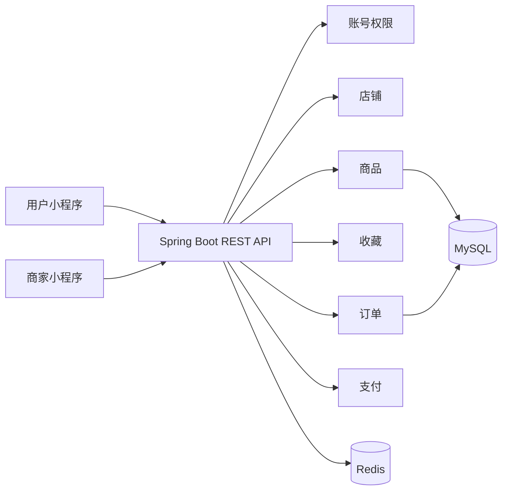

# 星屿架构约定

一个仓库、两个小程序、一个后端应用、一套 MySQL 和 Redis。后端按业务能力分包，整体编译、整体部署。



此图表达目标模块划分。当前仅实现商品只读接口，其他模块通过 `package-info.java` 记录边界，避免把预留目录误认为已完成的业务。

## 模块边界

| 包 | 负责的业务 | 后续拥有的数据 |
| --- | --- | --- |
| identity | 用户身份、微信登录、角色与访问控制 | 用户、外部身份、角色 |
| shop | 商家入驻、店铺状态、店铺成员 | 店铺、成员关系 |
| catalog | 商品、规格、上下架、库存 | 商品、SKU、库存流水 |
| favorite | 收藏和取消收藏 | 用户收藏关系 |
| order | 下单、订单项快照、状态流转 | 订单、订单项 |
| payment | 支付单、支付渠道、回调幂等 | 支付单、回调记录 |
| shared | 通用响应及分页等基础类型 | 不拥有业务数据 |
| config | 框架与基础设施装配 | 不承载业务逻辑 |

每个业务模块的对外接口及 DTO 放 `api`，实现与数据访问放 `internal`。跨模块调用使用对方的公开业务接口，不依赖对方的内部实现。暂不拆 Maven 子模块，避免为目录结构增加构建成本。

当前商品读模型联合查询店铺状态和名称，用于过滤停业店铺；这是明确保留的读侧关联。写操作由对应模块拥有，后续商品写入、库存扣减和订单流转不得跨模块直接更新数据表。

## 接口约定

接口前缀为 `/api/v1`，请求与响应采用 JSON；成功响应如下：

```json
{
  "code": 0,
  "message": "ok",
  "data": {
    "items": [],
    "total": 0,
    "page": 1,
    "size": 20
  }
}
```

当前商品列表为 `GET /api/v1/products?q=&page=1&size=20`。`page` 从 1 开始，`size` 范围 1–100，关键词最长 100 个字符。仅返回正常营业店铺的已上架商品，按商品 ID 倒序排列。

业务 ID 使用字符串传给前端，避免 JavaScript 对大整数丢失精度。金额在数据库使用 `DECIMAL`，在 JSON 中使用十进制字符串，前端展示时不转换为浮点数。HTTP 状态表达请求结果，已实现的业务接口在 JSON 中同时提供 `code` 和 `message`；健康检查和 OpenAPI 保持各自标准格式。

当前未提供任何登录账号或令牌签发接口。私有接口默认拒绝访问，浏览器仅允许配置中的 CORS 来源。接入微信登录后再补充令牌验证、角色授权和店铺归属校验，继续保持权限默认关闭。

## 数据与运行约定

- 表结构由 Flyway 迁移脚本管理，已应用的脚本不修改，通过新版本继续迁移。
- 初始迁移仅创建店铺、商品两张表及约束；开发数据库不填充假商品。测试数据只存在于 Testcontainers 的临时数据库。
- 商品价格与库存由数据库约束兜底。后续下单使用事务和带条件的库存更新，Redis 不承担库存或支付结果的唯一事实来源。
- 新增支付能力时，订单金额和商品快照由后端计算，支付回调验签并按支付流水幂等处理。
- Redis 先用于限流、临时状态和有实际收益的热点缓存，再按需要扩展。
- 商品图片与头像后续通过文件存储适配器连接对象存储，数据库保存文件引用，不把二进制文件塞入业务表。
- 开发配置与密钥来自本地 `.env`；数据库、Redis 和后端默认只绑定本机地址。

## 验证范围

`ApplicationIntegrationTest` 使用真实 MySQL 8.4 和 Redis 容器，验证 Flyway 建表、商品可见性、分页和关键词绑定、金额与大整数精度、数据库约束、错误参数、私有接口拦截、CORS、Redis 连通性、健康检查和 OpenAPI。前端通过 TypeScript 检查，并分别构建微信小程序与 H5；微信真机能力需要真实 AppID 后另行验收。
