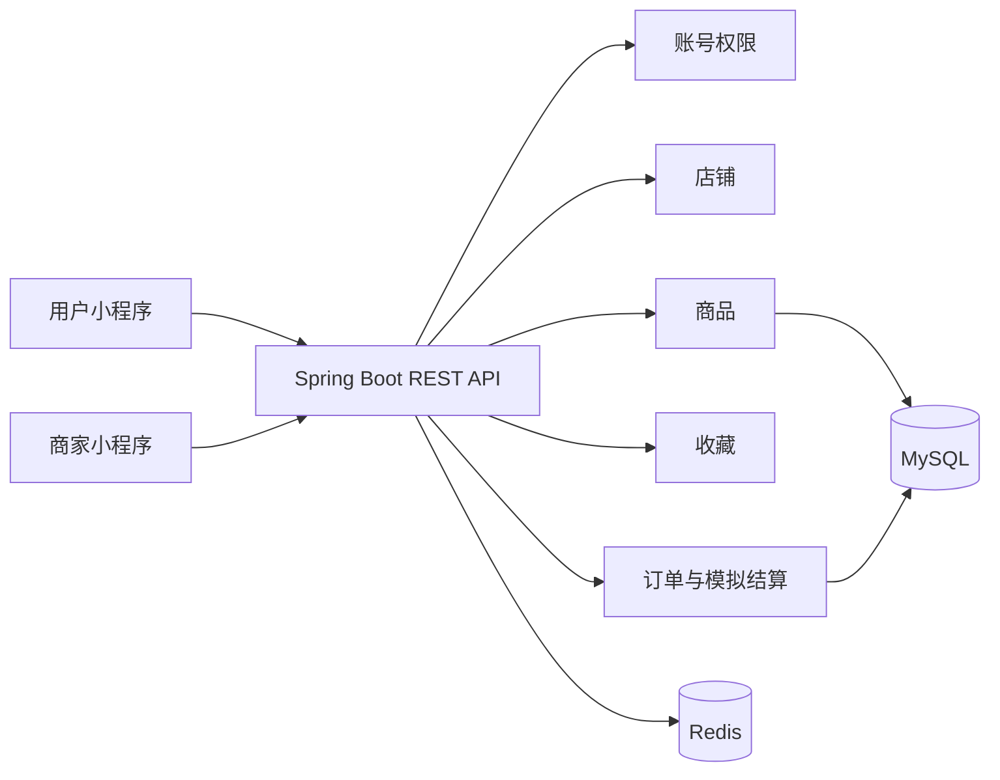

# 星屿架构约定

一个仓库、两个小程序、一个后端应用、一套 MySQL 和 Redis。后端按业务能力分包，整体编译、整体部署。



此图表达目标模块划分。Spring Boot 已实现手机号账号、角色会话、店铺审核、商品发布和模拟支付到收货的流程。小程序可通过 `VITE_MARKETPLACE_BACKEND=spring` 接入。同一笔结算在 MySQL 事务内完成价格校验、扣减库存和按店铺建单。

## 模块边界

| 包 | 负责的业务 | 后续拥有的数据 |
| --- | --- | --- |
| identity | 用户身份、微信登录、角色与访问控制 | 用户、外部身份、角色 |
| shop | 商家入驻、店铺状态、店铺成员 | 店铺、成员关系 |
| catalog | 商品、规格、上下架、库存 | 商品、SKU、库存流水 |
| favorite | 收藏和取消收藏 | 用户收藏关系 |
| order | 模拟支付、下单、订单项快照、履约和模拟退款 | 结算记录、订单、订单项和售后记录 |
| shared | 通用响应及分页等基础类型 | 不拥有业务数据 |
| config | 框架与基础设施装配 | 不承载业务逻辑 |

每个业务模块的对外接口及 DTO 放 `api`，实现与数据访问放 `internal`。跨模块调用使用对方的公开业务接口，不依赖对方的内部实现。暂不拆 Maven 子模块，避免为目录结构增加构建成本。

当前商品读模型联合查询店铺状态和名称，用于过滤停业店铺；这是明确保留的读侧关联。写操作由对应模块拥有，后续商品写入、库存扣减和订单流转不得跨模块直接更新数据表。

## 接口约定

接口前缀为 `/api/v1`，请求与响应采用 JSON；成功响应如下：

```json
{
  "code": 0,
  "message": "ok",
  "data": {
    "items": [],
    "total": 0,
    "page": 1,
    "size": 20
  }
}
```

当前商品列表为 `GET /api/v1/products?q=&page=1&size=20`。`page` 从 1 开始，`size` 范围 1–100，关键词最长 100 个字符。仅返回正常营业店铺的已上架商品，按商品 ID 倒序排列。

业务 ID 使用字符串传给前端，避免 JavaScript 对大整数丢失精度。金额在数据库使用 `DECIMAL`，在 JSON 中使用十进制字符串，前端展示时不转换为浮点数。HTTP 状态表达请求结果，已实现的业务接口在 JSON 中同时提供 `code` 和 `message`；健康检查和 OpenAPI 保持各自标准格式。

| 接口 | 用途 |
| --- | --- |
| `POST /api/v1/auth/register`、`POST /api/v1/auth/login` | 提交 `phone`、`password` 和 `role`。`user` 和 `merchant` 可注册登录，`admin` 可登录。商家注册可提供 `shopName`，店铺初始状态为 `PENDING`。 |
| `POST /api/v1/auth/logout` | 撤销当前 Bearer 会话。 |
| `GET /api/v1/products/{id}` | 查询公开商品详情及规格。 |
| `GET /api/v1/merchant/products` | 按页查看自家商品及上架状态。 |
| `POST /api/v1/merchant/products` | 创建草稿或上架商品，填写标题和至少一个含名称、价格、库存的规格。 |
| `PUT /api/v1/merchant/products/{id}` | 保存商品及规格。提交 `expectedVersion`，已有规格修改库存时同时提交 `expectedStock`，省略库存时保留当前值。 |
| `POST /api/v1/merchant/product-images`、`GET /api/v1/images/{id}.jpg` | 商家通过 multipart 字段 `file` 上传图片，再按返回的地址读取。商品可绑定本店上传的图片。 |
| `GET /api/v1/merchant/products/{id}`、`PATCH /api/v1/merchant/products/{id}/publication` | 查看自家商品，或提交 `published` 切换上下架。店铺营业后方可上架。 |
| `GET /api/v1/admin/shops/pending`、`POST /api/v1/admin/shops/{id}/approve` | 管理员查询待审核店铺并开通营业状态。 |
| `GET /api/v1/marketplace` | 同步商品、店铺、订单和评价。公开评价使用脱敏昵称，只有买家本人可以取得评价关联的订单和明细编号。 |
| `POST /api/v1/orders/checkout` | 模拟支付并按店铺建单。使用 `X-Idempotency-Key` 重试时复用原订单，同一键绑定同一份请求。 |
| `POST /api/v1/merchant/orders/{id}/shipment`、`POST /api/v1/orders/{id}/receipt` | 商家记录物流，买家确认收货。 |
| `POST /api/v1/orders/{id}/refunds` | 买家申请整单仅退款或退货退款，使用 `X-Idempotency-Key` 重试。 |
| `POST /api/v1/orders/{id}/refunds/{refundId}/cancel` 和 `…/shipment` | 买家撤销售后或提交退货物流。 |
| `POST /api/v1/merchant/orders/{id}/refunds/{refundId}/decision` 和 `…/receipt` | 商家审核申请或确认收到退货。退款状态和库存更新在同一事务内完成。 |
| `POST /api/v1/orders/review-images` | 买家通过 multipart 字段 `file` 上传评价图片，评价只能绑定本人上传的图片。 |
| `POST /api/v1/orders/{orderId}/items/{itemId}/review`、`POST /api/v1/merchant/reviews/{id}/reply` | 买家对已完成订单的明细评价，商家回复本店评价。两个接口都使用 `X-Idempotency-Key` 重试。 |

注册和登录返回 `token` 与 `expiresAt`。商家接口通过 Bearer 令牌校验角色，通过店铺归属限制详情和写入操作。密码和会话令牌分别保存哈希和摘要。首次初始化管理员时同时设置 `STARISLE_ADMIN_PHONE` 和 `STARISLE_ADMIN_PASSWORD`，密码长度为 12–128 位。未设置时可正常启动，管理员账号需要另外初始化。

## 数据与运行约定

- 表结构由 Flyway 迁移脚本管理，已应用的脚本不修改，通过新版本继续迁移。
- V1 创建店铺和商品表，V2 增加账号、角色、会话、店铺归属和规格。V3 为旧商品生成默认规格并补充目录字段，V4 增加结算记录、订单及订单项快照，V5 增加商品编辑版本及图片归属，V6 增加售后状态和历史记录，V7 增加订单明细评价和买家图片归属，V8 增加商品视频及店铺归属。测试数据在 Testcontainers 的临时数据库中单独准备。
- 商品价格与库存由数据库约束兜底。后续下单使用事务和带条件的库存更新，Redis 不承担库存或支付结果的唯一事实来源。
- 模拟支付由后端计算订单金额和商品快照，使用结算请求的幂等键避免重复建单。模拟退款记录售后结果，整个流程不接入微信支付及支付回调。
- Redis 先用于限流、临时状态和有实际收益的热点缓存，再按需要扩展。
- 商品和评价图片共用文件存储。数据库分别保存店铺或买家归属，商品或评价只能绑定对应归属的上传图片。修改商品图片时保留原文件供历史订单读取。
- 开发配置与密钥来自本地 `.env`；数据库、Redis 和后端默认只绑定本机地址。

## 验证范围

`ApplicationIntegrationTest` 使用真实 MySQL 8.4 和 Redis 容器，验证 Flyway 建表、商品可见性、分页和关键词绑定、金额与大整数精度、数据库约束、错误参数、私有接口拦截、CORS、Redis 连通性、健康检查和 OpenAPI。前端通过 TypeScript 检查，并分别构建微信小程序与 H5；微信真机能力需要真实 AppID 后另行验收。
